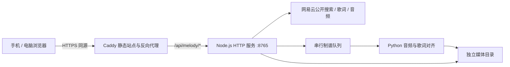

# 指尖旋律：游戏、架构与部署说明

更新：2026-11-04。当前存储模型以文末“设备曲库”一节为准。本文描述仓库中已实现的功能；服务器部署文件已提供，不代表线上服务已经发布。

## 1. 游戏是什么

指尖旋律是韭菜盒子中的中文四轨音游。黑白块被歌词字块替代，一个汉字对应一次点击；手机触摸轨道，电脑使用鼠标或 D / F / J / K。每次游玩完整歌曲，没有一分钟截取选项。

| 模式 | 音乐推进 | 失误处理 |
| --- | --- | --- |
| 计分模式 | 保持原速，跟随开唱时刻点击 | 漏字和点错降低成绩，不结束游戏 |
| 节奏模式 | 点击放行下一段音乐，点击速度影响播放速度；不点就在下个字前等待 | 点错不推进，允许一直等待 |
| 欣赏模式 | 原速播放，歌词块到判定线自动触发；判定点击无效 | 自动满分，不计入历史；无谱面时可纯听歌 |

节奏模式只有一个音频播放实例，设置 `preservesPitch=true`，速度范围 0.65–2 倍。暂停边界受浏览器调度影响，并非采样级音频引擎。前奏、尾奏仍会播放。

### 分数与评级

Perfect 的点击误差不超过 110ms，Good 不超过 240ms。基础得分分别为 100 / 60，连击每十次增加 5 分奖励，上限 50。

评级使用未四舍五入的准确率：`(Perfect + Good × 0.6) / (总字数 + 点错数) × 100%`。

| 评级 | 条件，按从上到下优先判断 |
| --- | --- |
| φ | 全部字 Perfect，且没有点错 |
| V | 准确率 ≥ 95% |
| S | 准确率 ≥ 90% |
| A | 准确率 ≥ 80% |
| B | 准确率 ≥ 70% |
| C | 准确率 ≥ 60% |
| F | 低于 60%，包括空谱面 |

结算顶部显示评级，最大数字仍是分数。计分和节奏模式分别保存最高分，首页卡片显示计分模式纪录。欣赏模式不保存成绩。最高分保存在当前浏览器 `localStorage`，未做账号同步。

### 音块与视觉

- 字块时刻取自逐字谱面，显示高度至少 20px；拉高显示不会推迟点击时刻。
- 同句优先相邻列移动，句首偏向两侧；叠词同列同色，重复歌词或相似旋律复用基础轨道。
- 急促歌词允许不同列的字块在视觉上重叠。四列都被占用时仍可能出现重叠，需要结合谱面检查。
- 每首歌选择主题色卡，字块从色卡中变化；页面有渐变、几何律动、原创合成器背景音乐和按钮音效。
- 游戏顶部仅有返回、歌名、暂停；准备和结算时该按钮为设置。设置面板包含模式、音量、延迟及返回/继续/重开。

## 2. 技术架构

没有 React、Vue 或前端打包框架：前端是 HTML、CSS、原生 JavaScript ES Modules，采用 DOM 字块和 `requestAnimationFrame` 绘制。浏览器负责交互、计分、音频播放；Node.js 负责只读曲库、音源转发与临时制谱；Python 负责音频处理。



### 文件职责

| 文件 | 职责 |
| --- | --- |
| `index.html` / `style.css` | 选歌、搜索、导入、轨道、暂停与结算界面 |
| `game.mjs` | 页面状态、音频加载、游戏循环、最高分 |
| `engine.mjs` | 轨道布局、两种玩法、判定与评级 |
| `transport.mjs` | 单音轨播放、保调变速、节奏等待 |
| `menu-audio.mjs` | 首页纯音乐和按钮音效 |
| `device-library.mjs` | IndexedDB 缓存、删除与浏览器 YRC 制谱 |
| `song-archive.mjs` / `vendor/fflate.mjs` | 浏览器本地 ZIP 批量导入和导出 |
| `catalog.mjs` / `library-search.mjs` | 搜索排序、去重、下载与导入进度 |
| `service.mjs` | 同源 API；仅开发时允许连接本机备用端口 |
| `scripts/server.mjs` | HTTP API、只读媒体访问、音源转发和临时处理 |
| `scripts/netease.mjs` | 网易云搜索、歌词和音频可用性探测 |
| `scripts/align.py` | LRC / YRC、WhisperX / SOFA、节拍与谱面输出 |
| `scripts/vocal_tails.py` | 人声分离及句尾收音测量 |
| `scripts/fetch-songs.mjs` | 本地调试用种子曲库下载 |
| `deploy/fingertip-melody.service` | Linux 后台常驻服务，位于仓库根目录的 deploy 中 |
| `deploy/setup-melody.sh` | 后端环境安装，位于仓库根目录的 deploy 中 |

### 为什么不是完全无服务器

Listen1 使用浏览器扩展的 `host_permissions` 和后台请求能力，普通网页不能直接获得这些能力。模型也不是把 Python 文件复制进网页即可运行：当前 WhisperX、SOFA、Demucs 都使用本地 Python/PyTorch，模型下载量和内存占用不适合要求所有手机即时执行。

因此当前方案是：服务器安装一次，访问者只打开网页，不安装插件、Python 或模型。已有音频加 YRC 的纯浏览器导入技术上可单独实现，但当前版本统一交由后端处理，没有声称已经实现纯前端离线制谱。

参考：[Chrome 扩展跨域权限](https://developer.chrome.com/docs/extensions/develop/concepts/network-requests)、[浏览器模型运行与 WebGPU](https://huggingface.co/docs/transformers.js/guides/webgpu)。

## 3. 曲库、下载与上传

结果顺序为：已下载歌曲 → 有公开音频的 YRC 歌曲 → 普通公开音频 → 会员/付费资源 → 暂不可用资源。用来源和录音 ID 去重，不把同名翻唱当成同一版本。

“逐字”表示来源提供 YRC，不表示音频免费或已经生成可玩谱面。服务探测公开音频的实际响应，网络失败不会直接标成会员。网络资源状态缓存三分钟；现阶段仅接网易云，未实现 QQ、酷狗或会员登录。

下载和导入只保存到当前浏览器 IndexedDB，不修改服务器曲库。浏览器支持的音频 + YRC 完全本地制谱；普通 LRC 使用服务器临时目录制谱后返回结果，清除临时文件。浏览器不支持的格式可临时转成 MP3。服务器自带歌曲作为只读种子提供。

音频上限 80MiB，歌词上限 2MiB，请求总上限 83MiB。YRC 不含音频，必须匹配同一录音；仅音频先收藏，之后附歌词重新导入。明显短于元数据时长的试听片段会拒绝。

设备曲库不跨设备同步，清除站点数据会删除缓存。删除按钮清理缓存并隐藏该歌曲，服务器种子文件保持不变；重新下载可恢复。旧服务器上传仍按原 Cookie 隔离，但新导入不使用此存储方式。临时制谱一次处理一个请求，忙时提示稍后重试。

### ZIP 曲库交换

导入区可直接选择 ZIP。没有清单时，同目录同名的 `歌名.mp3`、`歌名.yrc` / `歌名.lrc`、`歌名.json` 会配成一首；同名 `.url` / `.txt` 中的单个 HTTP(S) 音频链接也可代替音频。JSON 可含 `title`、`artist`、`mood` 等歌曲信息，或使用 `{ "song": {...}, "chart": {...} }`。音频链接需允许浏览器跨域下载；若被源站禁止，导入该首会报错。

导出设备曲库或批量管理中选择歌曲后导出，会生成可重新导入的 ZIP，其中 `melody-manifest.json` 的 `songs` 数组逐首列出 `song`、`audio`、`lyrics`、`chart` 路径。只读的服务器种子曲目需要先下载到设备曲库才能导出。压缩包处理和 YRC 制谱不依赖服务器，普通 LRC 的自动对齐仍依赖服务端。单首音频上限 80MiB；ZIP 上限 250MiB，解压总量上限 400MiB。

## 4. Windows 本地启动

需要 Node.js 22+、Python 3.12、Git。以下命令在仓库根目录执行：

```powershell
# 首次准备环境；-Python 应指向 Python 3.12
./games/fingertip-melody/scripts/setup-alignment.ps1 -Python python

# 可选：准备调试种子歌曲，并批量制谱
node games/fingertip-melody/scripts/fetch-songs.mjs
./games/fingertip-melody/.venv/Scripts/python.exe games/fingertip-melody/scripts/align.py

# 启动网页和本地 API
node games/fingertip-melody/scripts/server.mjs
```

也可双击 `启动曲库.cmd`。访问 `http://127.0.0.1:8765/games/fingertip-melody/`。这是开发入口，不是让手机访问电脑 localhost 的部署方案。

默认安装约 25MB 的 lite INT8 模型。高级制谱可选安装 WhisperX、Demucs 和 SOFA，详见 README 的安装开关。音频、模型、虚拟环境未提交 Git，新检出需要重新准备。

## 5. Linux 服务器部署：与 21 点共用站点入口

### 目录与端口

| 项目 | 默认值 |
| --- | --- |
| 源码目录 | `/home/ubuntu/apps/aios-src` |
| 后端代码 | `/home/ubuntu/apps/fingertip-melody` |
| 媒体与任务 | `/var/lib/fingertip-melody/media` |
| 模型运行缓存 | `/var/lib/fingertip-melody/cache` |
| Node 可执行文件 | `/home/ubuntu/.local/node/bin/node`，与现有 API 的约定一致 |
| Python 环境 | 后端代码目录下 `.venv` |
| 服务监听 | `127.0.0.1:8765`，不直接开放公网端口 |
| 公网入口 | 现有 HTTPS 网站的 `/api/melody/*` |

### 安装后端

服务器需要 Python 3.12（含 venv）、Node.js 22+、Git、rsync、curl，以及足够的模型缓存和媒体空间。当前 systemd 将进程内存上限设为 6GiB；服务器内存不足会中断制谱，应按实际硬件调整并验证，不代表小内存主机一定可运行。

把本次源码放到上述源码目录后执行：

```bash
cd /home/ubuntu/apps/aios-src
sudo bash deploy/setup-melody.sh
curl --fail http://127.0.0.1:8765/api/melody/health
```

脚本默认安装 lite 依赖和模型、systemd 服务并启动后端。已有 `server.env` 不覆盖。设置 `MELODY_INSTALL_ADVANCED=1` 才会安装并预热高级模型。

现有本地媒体不在 Git：可先把要共享的媒体放入服务器源码目录的 `games/fingertip-melody/media`，安装脚本只在目标曲库为空时初始化，跳过个人上传文件。也可以从空曲库开始，访问者在网页下载到各自设备。不要把 Windows `.venv` 直接复制到 Linux 使用。

### 配置站点路由并发布前端

仓库 `deploy/aios.Caddyfile` 已加入独立的 `/api/melody/*` 路由，位于通用 `/api/*` 之前，转发至 `127.0.0.1:8765`，不影响 21 点的 `/ws` 和 `/api/room/*`。同时禁止通过静态站点访问旋律的 scripts、media、模型和虚拟环境。

更新服务器静态前端及 `/etc/caddy/aios.Caddyfile` 后，沿用现有独立 Caddy 实例的验证与重载方式：

```bash
sudo -u caddy env XDG_DATA_HOME=/var/lib/caddy-aios/data XDG_CONFIG_HOME=/var/lib/caddy-aios/config \
  /usr/bin/caddy validate --config /etc/caddy/aios.Caddyfile
sudo systemctl reload aios-caddy
```

现有 `deploy/deploy-aios.sh` 包含整个站点发布与服务重启操作，不是只部署本小游戏的无影响命令；按原站点发布流程审阅后使用。该脚本已排除模型、媒体、虚拟环境与 Python 后端源码的静态同步。

完成后手机直接访问同一 HTTPS 游戏地址。不要把手机端接口改成 `127.0.0.1`，也不需要浏览器插件。代码和本地测试通过不等于服务已经部署，必须验证公网同源接口。

### 配置和运维

`server.env` 由安装脚本生成，关键字段：

```ini
MELODY_PORT=8765
MELODY_ORIGINS=https://124.222.183.43:8443,https://sunflower.dpdns.org
MELODY_MEDIA_DIR=/var/lib/fingertip-melody/media
MELODY_PYTHON=/home/ubuntu/apps/fingertip-melody/.venv/bin/python
```

上线域名变动时更新 `MELODY_ORIGINS`，必须含准确的协议和端口，再重启服务。只接受配置来源的写入请求；生产 Cookie 使用 Secure。服务只信任本机反向代理提供的真实 IP，用于查询和提交限流。

```bash
sudo systemctl status fingertip-melody --no-pager
sudo journalctl -u fingertip-melody -n 100 --no-pager
sudo systemctl restart fingertip-melody
```

`health` 只证明 HTTP 服务存活，不证明首次模型下载或所有歌曲对齐已经成功。上线验收需实测搜索、一次下载、一次音频 + YRC 上传，以及普通 LRC 制谱。

## 6. 歌词对齐和延音算法

### 6.1 输入清理

LRC 是整句时间戳。解析时保留空行和署名的时间边界，但过滤制作人、词曲、公司、版权、中英混排编曲信息和独立语言/间奏标注，不生成对应音块。当前只处理汉字；英文歌词不生成点击音块。

### 6.2 优先使用原生 YRC

YRC 提供每个 token 的起点和长度。仅接受可映射到单个汉字的时间轴，检查时间非负、长度有效、未超出音频长度。合格 YRC 直接制谱，不加载 WhisperX 或 SOFA。若 token 包含多个汉字或时间轴不合格，则改用对应 LRC 做音频对齐，不把一段时间平均分给多个字。

YRC 必须与录音版本匹配：原唱、翻唱、Live、变速版之间不可复用时间轴。

### 6.3 普通歌词默认使用 lite

默认使用约 25MB 的 Zipformer-small INT8 中文 CTC 模型，以已知歌词约束 token 路径。句首前扩 700ms、句尾后扩 500ms，逐句计算，解码文件放在临时目录。模型在安装时准备。低置信句标记听校，极低置信或无有效路径的句子退为练习。具体阈值、缓存与安装命令见 README。

高级制谱通过首页“制谱设置”开启，需服务器依赖、模型缓存检测通过。检查不加载模型。请求默认后端为 lite，显式请求不可用的 WhisperX 返回 503，客户端保留音频供重试。

### 6.4a 轻量句尾

追踪末字 CTC 帧之后连续且相近的混音频谱，持续 120ms 衰减视为结束，最多额外搜索 12 秒。以之后实际字点为上界；不确定时保留听校标记。轻量谱的 beats 为空、bpm 为 0，重复歌词仍能复用轨道。

### 6.4b 高级句尾的 SOFA 初值与人声收音

CTC 常把句尾字压成约 20ms 的识别帧。SOFA 中文歌声模型先提供句尾补偿，仅在末字起点相差不超过 600ms 且时长合法时采用。

随后使用 torchaudio `HDEMUCS_HIGH_MUSDB_PLUS` 将人声从混音中分离；按原音频 SHA256 缓存人声。在已确定的末字起点之后，以 30ms 能量窗口、10ms 步长检测连续人声。持续 120ms 低于相对阈值时视为收音，停止于下一字所在乐句之前，不跨过静音寻找后续人声，也不强制延长到下一句。

该步骤仅修正句尾结束点，不修改 WhisperX 的点击起点。不能确认人声的字标记 `tailReview`；异常短或超过 3 秒的时值也提示听校。长音不因超过 3 秒而被裁掉，3 秒只是检查阈值。

这是声学估计，合唱、和声、换气、弱音及分离残留仍可能影响结束点。20px 只是显示下限，不能用来判断实际时长是否正确。

### 6.5 节拍、旋律与输出

高级后端使用 librosa 分离打击成分并跟踪节拍，另用 chroma 特征和字数/重复歌词识别相似乐句。最终 JSON 包含：

- `version`、`duration`、`method`、`tailMethod`；
- `audioSha256`、`lyricSha256`，用于录音版本校验；
- `bpm`、`beats`；
- `lines`：句起点、文字、可玩标记、旋律编号；
- `words`：汉字、起点、结束点、所属句、对齐置信度；
- `review`：需要人工听校的时值索引。

浏览器加载时再次校验音频摘要，拒绝音频与谱面错配。

单歌制谱和已有谱面句尾修复：

```powershell
./games/fingertip-melody/.venv/Scripts/python.exe games/fingertip-melody/scripts/align.py --audio song.mp3 --lyrics song.lrc --output song.chart.json
./games/fingertip-melody/.venv/Scripts/python.exe games/fingertip-melody/scripts/vocal_tails.py song.mp3 song.chart.json
```

## 7. 接口与验证

| 方法与路径 | 用途 |
| --- | --- |
| `GET /api/melody/health` | 服务存活状态 |
| `GET /api/melody/search?q=...` | 网络资源检索与可用性探测 |
| `GET /api/melody/library` | 共享曲库和当前浏览器的个人上传 |
| `GET /api/melody/resource?id=…` | 歌曲元数据与歌词 |
| `GET /api/melody/audio?id=…` | 公开音频流转发，不落盘 |
| `POST /api/melody/prepare` | 临时音频转换 / LRC 制谱，返回结果后清理 |
| `POST /api/melody/download` | 已停用，返回 410 |
| `POST /api/melody/upload` | 已停用，返回 410 |
| `GET /api/melody/media/:filename` | 鉴权后的音频、歌词与谱面读取 |

```powershell
node --test games/fingertip-melody/*.test.mjs
./games/fingertip-melody/.venv/Scripts/python.exe -m unittest discover -s games/fingertip-melody/scripts -p test_alignment.py
```

测试覆盖评级边界、节奏与计分、显示最小高度、叠词、时间轴校验、句尾收音、搜索排序、上传输入验证、来源检查和个人媒体隔离。手机布局可在浏览器模拟，但真实移动设备的音频延迟、系统后台暂停和首次播放授权仍需实机验证。

## 卡片与搜索展示更新

首页暂隐藏模式选择，默认计分模式；暂停面板仍可切换玩法，返回列表后恢复计分模式。搜索每个分类默认显示 10 条，加载更多每次展开该分类的 10 条结果（当前上游每次搜索最多返回 30 首）。最高评级独立保存在浏览器，历史只有分数的记录显示“—”，不根据分数猜评级。准备和结算卡片使用歌曲封面叠加半透明渐变，封面缺失或加载失败时使用歌曲印象色渐变。封面来自歌曲元数据，需要网络访问。

## 设备曲库（最新实现）

下载和导入改为 IndexedDB 保存音频 Blob、歌词及谱面，仅属于当前站点、当前设备浏览器。清除站点数据会删除这些歌曲，隐私模式和浏览器存储配额可能限制保存。服务器自带曲库作为只读种子展示。

- 卡片“删除”移除此设备保存的歌曲；服务器种子歌曲只在此设备隐藏，不修改服务器目录。重新下载同一歌曲会解除隐藏。分数纪录保留。
- 音频 + 真正逐字 YRC：浏览器解析、校验时间轴与音频摘要，直接可玩，不上传文件、不加载 WhisperX。保留原生尾音；同句重复歌词仍复用轨道。此路径没有运行 librosa，不生成假节拍或旋律相似检测，beats 为空、bpm 为 0。
- 仅音频：保存到设备，之后附歌词重新导入。
- 普通 LRC：先保存音频，再调用 `/api/melody/prepare` 临时转换/lite 制谱，按设置可选 WhisperX；服务在操作系统临时目录处理，成功或失败后清除，结果保存回设备，不写入共享 library.json。制谱期间需保持页面打开；失败保留本地音频，可重新导入重试。进程被强制终止时的残留由系统临时目录清理策略处理。
- `/api/melody/resource?id=…` 返回元数据和歌词，`/api/melody/audio?id=…` 只转发公开音频，不落盘。旧 download/upload 接口返回 410，避免旧页面继续改写服务器曲库。
- 完全静态部署可以导入受浏览器支持的音频 + YRC 并游玩；在线搜索/下载仍需音源允许 CORS，当前采用同源转发服务。YRC 本身不包含音频，也不绕过音源会员权限。普通 LRC 仍依赖 Python 环境。

已删除本机服务器曲库误下载的《牵丝戏》黄龄 / 梦幻西游版本（1488294593），保留其他版本。

## 搜索反馈与会员登录边界（2026-11-03）

搜索时显示旋转加载提示；下载中的歌曲按钮显示旋转动画并暂时禁用。`media` 的歌词、逐字谱面、曲库索引现纳入 Git；MP3/WAV 仍忽略，公开音频地址见 [音频下载链接](./media/音频下载链接.md)。

点击会员曲目后可在本站使用 NeteaseCloudMusicApi 扫码登录。首次手动启动前，在游戏目录运行 `npm ci --ignore-scripts`。扫码确认后服务将网易云凭据保存在对应设备的内存会话中，最长 24 小时，可主动退出。搜索时仅将账号实际取得下载地址的曲目前移。试听片段仍需经过完整时长校验。

## 日文与手动制谱

日文 YRC 支持汉字、平假名、片假名和长音符。来源将多个假名放在同一个时间段时，保留一个音块，不均分时间。日文普通歌词不自动调用中文对齐模型。

在准备页设置中选择「手动制谱」，输入每句一行的歌词。音乐按原速播放，按任意轨道或 D/F/J/K 记录当前字的起始时刻，下一次点击结束上一个字。可暂停后继续；切换模式或重新开始会清空本次记录。曲末全部字录完后保存到当前设备，随后可切换计分模式演奏，手动制谱不记录历史分数。

### 手动制谱工作台

选择手动制谱后进入独立工作台，不再使用浏览器输入弹窗。优先加载设备保存的歌词，其次读取歌曲歌词文件，再使用已有谱面的歌词。支持导入 LRC、YRC 和 TXT 并随时编辑。编辑会自动暂停，保留字符相同的前缀字点；修改处之后需要重录。

工作台提供独立播放/暂停、四轨点击区、逐字进度、谱面时间窗口、播放位置滑条、撤销和保存按钮。按下记录起始，松开记录结束，长按可记录延音。歌词全部录完后主动保存，保存时校验时间轴并同时保存歌词到设备曲库。

### 独立页面

列表入口为 `index.html`，演奏页为 `play.html?song=来源:歌曲ID`，制谱页为 `chart-editor.html?session=草稿ID`。跨页重新读取 IndexedDB 音频，不依赖前页临时 Blob 地址。制谱草稿与音频保存在独立的本机 IndexedDB 会话中，刷新当前制谱地址可恢复已录字点。

制谱页采用四列竖向轨道，待录歌词随点击向判定线推进，已录字块随歌曲时间下落。底部为返回、撤销、播放/暂停、歌词编辑、保存五个 SVG 图标按钮；移动端可用歌词按钮展开编辑区。模式设置的四个入口统一为图标加文字，制谱入口名为「制谱模式」。

### 多谱面与局部修订

制谱页右上角打开谱面管理，可载入、重命名、删除当前歌曲的谱面；载入同时选择该谱面用于演奏。首次进入自动保留原始谱面，保存修改会新建一个版本并激活，不覆盖旧版本。删除当前版本时选择剩余第一个；删完后保留音频用于欣赏和重新制谱。

编辑歌词按钮位于歌词右侧。点击句号编号可选择当前句，编辑句子或使用重录按钮仅清除这一句的字点；点击单字后使用底部撤销按钮仅撤销该字，其余时间戳保留。重录时校验前后字的边界。保存成功显示独立提示和已保存状态。
